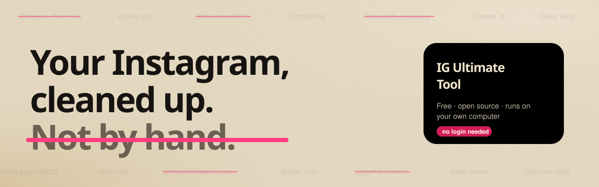

# IG Ultimate Tool

**Clean up your Instagram in minutes instead of days.** Free, open source, and it runs only on your own computer.

Unfollow people who don't follow you back, delete chats you haven't touched in months, leave old group chats, unlike and unsave everything, wipe old posts and comments, or **nuke** the whole account back to a fresh start. It also has an **AI auto-reply** that answers DMs the way you text, including photos, memes, voice notes and reels.

No modded Instagram app, no paying a social media manager, no giving your password to a website. Every line of code is right here for anyone to read.

**Just want to know who doesn't follow you back?** Use the [no-login checker on the website](https://soics.github.io/ig-ultimate-tool/): drop the data file Instagram gives you, and it's read in your browser without uploading anything.

[](https://github.com/soics/ig-ultimate-tool/actions/workflows/ci.yml) 

---

## What it can do

| | Tools |
|---|---|
| 👥 **Followers** | See who doesn't follow you back · unfollow them · unfollow everyone · unfollow a list you paste · remove followers you don't follow back · remove all followers · decline follow requests · a **keep-list** of people no tool will ever touch |
| 💬 **Chats** | Delete chats with no messages in the last *N* months (you pick *N*) · pick chats to delete · delete all chats · leave the group chats you pick, or all of them |
| 🖼️ **Posts** | Archive posts and reels (hidden, you can restore them) · delete them for good · only posts older than *N* months · restore archived posts · delete stories and highlights |
| ❤️ **Footprint** | Unlike everything you ever liked · unsave everything · delete all comments on your posts · remove yourself from photos you're tagged in |
| 🙍 **Profile** | Clear your bio, link and name · remove your profile picture · make the account private |
| ☢️ **Nuke** | All of the above in a safe order, to get a brand-new-looking account. Two confirmations plus a 5-second countdown you can cancel |
| 🤖 **AI auto-reply** | Answers DMs as you: **everyone**, only your **whitelist**, or only **usernames you paste**. Understands photos, memes, voice notes and reels. Free with Groq, or use Gemini, OpenRouter, Ollama, OpenAI, Claude, Claude Code or Codex |
| 🔎 **Username finder** | Hunts for a rare, clean username: short and rare words, words from 18 languages, luxury and dark styles, invented names. Every name gets an explainable quality score, the best are checked first at a human pace, and you claim a free one yourself (or let it claim automatically, unofficial and opt-in). Runs only while the page is open, remembers everything per account. Most short names are taken, so it can take days |

Everything that changes your account shows you the full list first, offers a **dry run**, and only starts after you type `yes`.

## Is it safe?

- **Your password is never saved.** You type it hidden; only Instagram's login session is kept, in a file only your user account can read.
- **Nothing goes anywhere except Instagram** (and, if you turn it on, the AI service you pick for auto-replies). No tracking, no servers of ours, no accounts.
- **It goes slow on purpose.** It waits between actions like a person would, and stops by itself the moment Instagram says "slow down". There's a Fast mode in Settings if you want it.
- **Stopped halfway? It continues** where it left off next time.

> ⚠️ **Be honest with yourself about the risk.** IG Ultimate Tool is not made by Instagram or Meta. Automating an account goes against Instagram's terms; Instagram can temporarily block actions ("Action Blocked") or, rarely, limit an account. Older, real accounts are much lower risk than brand-new ones. Deleting is permanent. You use it at your own risk.

## Start it (3 steps)

**1. Download.** Click the green **Code** button at the top of this page → **Download ZIP**. Unzip it (right-click → *Extract All* on Windows, double-click on Mac).

**2. Open it.**

| Windows | Mac | Linux |
|---|---|---|
| Double-click **`Start-Windows.bat`**. If a blue box says *"Windows protected your PC"*, click **More info → Run anyway** (it shows that for any new file from the internet). | Right-click **`Start-Mac.command`** → **Open** → **Open**. (Only the first time; after that, double-click.) | Open a terminal in the folder and run `./start-linux.sh` |

The first time, it sets itself up (a minute or two). It installs [uv](https://docs.astral.sh/uv/), a small tool that downloads the right version of Python for you, so you don't have to install anything yourself.

**3. Follow the screen.** Type `I agree`, then pick how you want to use it:

- **Use it in my web browser**: the easiest. A page opens with buttons and checkboxes (it runs only on your computer, nothing is online).
- **Try everything on a pretend account first**: look around safely, nothing real changes.
- **Log in here**: everything in the black window. Type the number you want and press Enter; **Ctrl+C** always goes back.

## AI auto-reply

Answers new DMs the way you text: photos, memes, voice notes and reels included. It only answers messages that arrive after you press Start, sends one message per reply, steps back if you reply yourself, and stays out of group chats unless you turn them on. If someone sincerely asks whether they're talking to a bot, it won't lie.

### Step 1: pick your AI

| You have... | Pick | Cost |
|---|---|---|
| Nothing yet, and want it free | **Groq** (recommended) | free |
| A **Claude Pro or Max** plan | **Claude Code** | included in your plan |
| A **ChatGPT Plus, Pro or Business** plan | **Codex** | included in your plan |
| A business, or you want the best replies | **Claude API key** or **OpenAI API key** | pay per use |
| You want nothing to leave your computer | **Ollama** | free, needs a decent PC |
| Your own AI server | **Any other OpenAI-compatible server** | your server |

- **A Claude or ChatGPT subscription is not an API key.** API keys are a separate pay-as-you-go account. Already paying for a plan? Use Claude Code or Codex, no key needed.
- **Groq (with a Q) is not Elon Musk's Grok.** It's a different company with a free tier.
- **Businesses:** use an API key billed to the business, not someone's personal plan.

### Step 2: set it up

The same steps show in the app when you pick an AI. Open the one you chose:

<details>
<summary><b>Groq (free, recommended)</b></summary>

1. Go to [console.groq.com/keys](https://console.groq.com/keys) and sign in with Google, GitHub or email. No card needed.
2. Click **Create API Key**, type any name (like `instagram`) and copy the key. It's shown only once.
3. In the tool, pick **Groq**, paste the key and press **Save and test**.
</details>

<details>
<summary><b>Google Gemini (free)</b></summary>

1. Go to [aistudio.google.com/apikey](https://aistudio.google.com/apikey) and sign in with a Google account.
2. Click **Create API key**. If it asks for a project, let it make one. Copy the key.
3. In the tool, pick **Google Gemini**, paste the key and press **Save and test**.
4. ⚠️ On the free tier Google may use your messages to improve its products. Prefer Groq for personal DMs.
</details>

<details>
<summary><b>OpenRouter (free models, low daily limit)</b></summary>

1. Sign up at [openrouter.ai](https://openrouter.ai).
2. Go to [openrouter.ai/keys](https://openrouter.ai/keys), click **Create Key** and copy it.
3. In the tool, pick **OpenRouter**, paste the key and press **Save and test**.
4. Free models have a small daily limit. A few dollars of credit raises it.
</details>

<details>
<summary><b>Ollama (free, private, runs on your computer)</b></summary>

1. Install Ollama from [ollama.com/download](https://ollama.com/download) and open it. It needs about 8 GB of RAM.
2. In a terminal, run `ollama pull gemma3` (about 3 GB; it also understands photos).
3. Leave Ollama running. In the tool, pick **Ollama** and press **Save and test**. No key needed.
</details>

<details>
<summary><b>OpenAI API key (paid)</b></summary>

1. A ChatGPT plan does **not** include API access. Have a plan? Use Codex instead.
2. Sign in at [platform.openai.com](https://platform.openai.com) and add credit under **Settings → Billing**.
3. Go to [platform.openai.com/api-keys](https://platform.openai.com/api-keys), click **Create new secret key** and copy it.
4. In the tool, pick **OpenAI API key**, paste the key and press **Save and test**.
</details>

<details>
<summary><b>Claude API key (paid)</b></summary>

1. A Claude Pro or Max plan does **not** include API access. Have a plan? Use Claude Code instead.
2. Sign in at [console.anthropic.com](https://console.anthropic.com) and buy credit under **Billing**.
3. Go to [Settings → API keys](https://console.anthropic.com/settings/keys), click **Create Key** and copy it.
4. In the tool, pick **Claude API key**, paste the key, choose which Claude (Haiku is cheapest) and press **Save and test**.
</details>

<details>
<summary><b>Claude Code (uses your Claude Pro or Max plan)</b></summary>

1. Install Claude Code ([full guide](https://code.claude.com/docs/en/setup)). Mac or Linux terminal: `curl -fsSL https://claude.ai/install.sh | bash`. Windows PowerShell: `irm https://claude.ai/install.ps1 | iex`
2. Open a new terminal, run `claude`, sign in with your Claude account, then type `/exit`.
3. Close and reopen IG Ultimate Tool so it finds Claude Code.
4. Pick **Claude Code** and press **Save and test**. No key needed; replies use your plan's limits and take a few seconds longer.
</details>

<details>
<summary><b>Codex (uses your ChatGPT plan)</b></summary>

1. Install [Node.js](https://nodejs.org), then in a terminal run `npm install -g @openai/codex` ([full guide](https://developers.openai.com/codex/cli)).
2. Run `codex`, choose **Sign in with ChatGPT**, then exit it.
3. Close and reopen IG Ultimate Tool so it finds Codex.
4. Pick **Codex** and press **Save and test**.
5. ⚠️ Codex can read **every file** on your computer account, so it only answers your whitelist or usernames you paste. Use it only with people you fully trust.
</details>

<details>
<summary><b>Your own server (advanced, for businesses)</b></summary>

1. Any server that speaks the OpenAI API works: LM Studio, vLLM, LiteLLM and others.
2. Pick **Any other OpenAI-compatible server** and enter its address ending in `/v1`. It must be `https://`, or `http://localhost` for a server on the same computer.
3. Paste the server's key if it needs one and press **Save and test**.
</details>

### Step 3: turn it on

1. **Personality**: your nickname and how you text ("lowercase, lots of lol, short replies").
2. **Who it replies to**: everyone, your whitelist, or usernames you paste.
3. **Try it first**: in the terminal version, *Try it here first* lets you chat with your AI without touching Instagram.
4. Press **Start replying**.

<details>
<summary><b>Compare the AIs (photos, voice notes, privacy)</b></summary>

| AI | Cost | Photos | Voice notes | Privacy |
|---|---|---|---|---|
| **Groq** (recommended) | free | ✅ | ✅ | DMs go to Groq |
| Google Gemini | free | ✅ | ❌ | ⚠️ free tier: Google may use messages to improve its products and reviewers may read them |
| OpenRouter | free models, low daily limit | depends | ❌ | DMs go to OpenRouter |
| Ollama | free | depends on model | ❌ | nothing leaves your computer, needs a decent PC |
| OpenAI / Claude API | paid | ✅ | OpenAI ✅ | not used for training |
| Claude Code / Codex | your subscription | ✅ | ❌ | goes through Anthropic / OpenAI; slower |

**Claude Code and Codex can read files**, so they're never allowed to answer *Everyone*, only your whitelist or pasted usernames; otherwise any stranger could ask the bot for your files.
- **Claude Code** runs locked down: with no *Agent folder* it reads nothing; give it one folder and it can read only that.
- **Codex** can read **every file your user account can**, whatever folder you pick. Only use it with people you trust completely.
</details>

## Username finder

1. Open **Username finder** > **Generator** and pick a style (Ultra OG, short or rare words, multilingual, luxury, dark, invented, letters + numbers, balanced, or your own list). 3-6 characters is the default sweet spot.
2. **Discovery** shows the best names not checked yet. Open one to see why it scored what it did. Star the ones you love (they're tried first), hide the ones you don't: the ranking learns your taste.
3. **Hunter** > **Start hunting**. It checks about 120 names an hour and slows down by itself when Instagram asks.
4. A name with no account shows up in **Results** as *possibly available*. That isn't proof (Instagram keeps names of banned accounts), so: copy it, change your username in the Instagram app, then press *I changed it: check my account*.

**Automatic claiming** is there too, but Instagram has no official way to claim a username, so it uses the same unofficial connection as the rest of the app. It's off unless you tick the box and type your username for that hunt, it renames your account the moment a name goes through (your old one becomes free for anyone), and the hunt stops after a confirmed success.

**It only hunts while the page is open.** Switching tabs or minimizing is fine. Close the page (or let the laptop sleep) and it stops within seconds, keeping its progress; press Start to go on. In the terminal version it hunts while that window is open and Ctrl+C stops it.

## Questions

<details><summary><b>Will I get banned?</b></summary>
Very unlikely on an aged, real account at the default speed. What you may see is Instagram's temporary "Action Blocked" after lots of actions; the tool stops by itself when that happens. Wait 24–48 hours and run it again: it continues where it stopped.
</details>

<details><summary><b>It says "experimental"?</b></summary>
Leaving group chats, removing tags, removing your profile picture and clearing your name use Instagram features we couldn't fully test on every account yet. If one fails, nothing else is affected. Please <a href="https://github.com/soics/ig-ultimate-tool/issues">open an issue</a> if it doesn't work for you.
</details>

<details><summary><b>Does it work with two-factor login?</b></summary>
Yes. It asks for the code. If Instagram asks "Was this you?", approve it in the Instagram app, wait 15 minutes and try again.
</details>

<details><summary><b>Where are my files? How do I remove everything?</b></summary>
Settings → <b>Log out of this computer</b> deletes the login. To remove everything, delete the folder you unzipped and this folder:<br>
Windows: <code>%LOCALAPPDATA%\IG Ultimate Tool</code> · Mac: <code>~/Library/Application Support/IG Ultimate Tool</code> · Linux: <code>~/.local/share/IG Ultimate Tool</code>
</details>

<details><summary><b>How do I update?</b></summary>
Download the ZIP again and use the new folder. Your settings and login stay where they are.
</details>

<details><summary><b>For developers</b></summary>

```bash
git clone https://github.com/soics/ig-ultimate-tool && cd ig-ultimate-tool
python -m venv .venv && . .venv/bin/activate
pip install -e ".[dev]"
pytest && ruff check .
ig-ultimate --preview
```
Every tool is a *plan* (targets + one action) run by one safe-action engine (`src/ig_ultimate/engine.py`). Tests run against a fake account that mirrors the real library; a contract test fails if the code calls anything that doesn't exist in [instagrapi](https://github.com/subzeroid/instagrapi).
</details>

---

Built on [instagrapi](https://github.com/subzeroid/instagrapi). Not affiliated with, endorsed by, or connected to Instagram or Meta. [MIT license](LICENSE): free to use, change and share, with no warranty.
